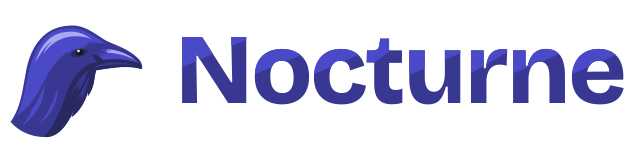

<h1><picture><source media="(prefers-color-scheme: dark)" srcset="site/public/brand/lockup-nocturne.svg"></picture></h1>

Nocturne is a dark-first design system for dense tool interfaces, and `@aiviarium/nocturne` is its SolidJS
component library: typed wrappers over the `nc-*` classes, plus layout, overlay, data, form and phone
components and a collaborative rich text editor. The stylesheets in `src/styles/` are the design system itself:
`tokens.css` holds the tokens and `bundle.css` the base classes.

## Install

The package is not published to a registry yet. Add it from a Git checkout or a packed tarball:

```sh
bun add solid-js
bun add @aiviarium/nocturne@file:../nocturne   # or a tarball from `bun pm pack`
```

`solid-js` 1.9 is a peer dependency. The package contains TypeScript sources (`exports` points at `src/index.ts`),
so build it with a bundler that compiles Solid JSX, such as Vite with `vite-plugin-solid`.

```ts
import "@aiviarium/nocturne/styles/index.css"
import { Button, DataTable, Composer } from "@aiviarium/nocturne"
```

`styles/index.css` loads `tokens.css`, `bundle.css` and `extra.css` in cascade layers (`reset`, `tokens`,
`components`, then `app` for your own CSS). Import each file yourself if you manage layers another way.

## Theming

```html
<div class="nc" data-theme="dark" style="--accent: #8b7cf6">…</div>
```

- Put `class="nc"` and `data-theme="dark"` or `data-theme="light"` on the app root.
- Set `--accent` on that element to change the accent. `ACCENTS` and `accentValue()` give the six presets the
  gallery offers.
- Popovers, menus, dialogs, tooltips and toasts mount inside the nearest `[data-theme]` element, so they
  inherit theme and accent.
- Component roots have a stable `data-part` attribute. Props are documented with TSDoc.

## What is in it

- Layout: `AppShell` (sidebar, top bar, status bar, phone drawer), `Frame` (with a `TabStrip` header),
  `ViewLayout` and `ViewHeader`, `Panel`, `Split` and `SplitGroup` (draggable, keyboard-resizable dividers),
  `Dialog` (centred, bare, near the top, or a bottom sheet). `LinkProvider` sends `NavItem` and `Button` links
  through your router.
- Overlays stack in a fixed order, lowest first: the phone drawer, the dialog's scrim, popovers, tooltips and
  toasts. A `Select`, menu or tooltip opened in a `Dialog` shows above it.
- `SchemaForm` builds a form from a JSON Schema (strings, numbers, booleans, enums, optional fields, nested
  objects, arrays of scalars, and arrays of small records as a `DataList`) and says what is wrong under each
  field. Secret strings (`writeOnly`, `format: "password"`, or the names in `secretFields`) are password inputs;
  those in `storedSecrets` already hold a value, are not required and are left out when blank. `x-multiline`
  strings are text areas. Numbers are `NumberField`s (`x-unit` for the unit). A number with both bounds and
  `"x-control": "slider"` is a `Slider` with its field.
- `RichTextEditor` is one editor for every rich text (documents, descriptions, comments, `richtext` fields):
  ProseMirror with one schema (`richTextSchema`), bound to a collaborative Yjs document (`provider`) or to a
  JSON value (`value`, `onChange`). It has block handles and a block menu, the `/` insert menu, a format bar,
  `@` mentions, `[[` page links, Markdown shortcuts and paste, tables, images and files, block types the app
  adds, remote cursors, read-only mode, `page`, `field` and `comment` variants and a phone layout. Top-level
  blocks of a `page` editor are `reading`, `wide` or `full` (`src/editor/width.ts`); the host sets the text
  column with `--nc-editor-measure` and the side space with `--nc-editor-inset`. The editor has no network
  code: mentions, chips, previews, uploads, the writing assistant's model call (and its wording, `aiCopy`),
  dictation and added block types come from `EditorServices` (`EditorServicesProvider`, or the `services`
  prop). `toMarkdown` and `parseMarkdown` convert documents to and from Markdown. Styles are
  `src/styles/editor.css`.
- `QueryBuilder` edits a `QueryGroup` (`src/lib/query.ts`): rules of field, operator and value in AND/OR groups
  one level deep. `toWhere` turns it into a structured `where` filter (text `contains` comes back as a
  `residual` for `matchQuery`, relative dates resolve against `now`), `fromWhere` reads one back, and
  `parseQueryText`/`printQueryText` read and write a query bar's text form. `NumberField`'s arithmetic is
  `evaluateExpression` (`src/lib/expression.ts`), a parser with no `eval`.
- `Composer` is a contenteditable field: picked `/` commands, `@` mentions and `$` skills are atomic chips, and
  its value is a list of text and chip segments (`ComposerValue`).
- Icons: `<Icon name="home" />` (the 48 core icons in `icons/`) or `<Icon node={Camera} />` with any icon from
  `lucide`.
- The phone layout and its scale are described in [docs/phone.md](docs/phone.md) and on the site's
  [Phones](site/content/docs/phones.mdx) page.
- CSS that the bundle lacks is in `src/styles/extra.css`, `parts.css` and the other files next to it.

## Which part for what

Build every view from the parts, so views look and behave alike however many teams or modules write them.
Do not restyle a part for one view. If it lacks something, add a variant to it.

The table of which part to use for what, with the sizes and rules of each part, is on the documentation site:
[`site/content/docs/parts/`](site/content/docs/parts/index.mdx). The rules for focus, contrast, colour and spacing
are on the pages [Focus and contrast](site/content/docs/focus.mdx), [Colour](site/content/docs/tokens/colour.mdx)
and [Sizes](site/content/docs/tokens/sizes.mdx).

## Documentation site

`site/` is the documentation site, published at https://nocturne.helight.dev/. It follows [aiviarium/docs-base](https://github.com/aiviarium/docs-base) at commit dcffeac. Its token
tables are made from `src/styles/tokens.css` at build time, and its examples are frames of the gallery, which the
site's build compiles into its output. See [site/README.md](site/README.md).

```sh
bun install && cd site && bun install
bun run dev      # http://localhost:3000
bun run build    # writes site/out/
```

## Commands

| Command | What it does |
| --- | --- |
| `bun install` | Installs the dependencies |
| `bun run gallery` | Component gallery on `127.0.0.1:4800`, one page per component, theme switch and six accent presets |
| `bun run gallery:build` | Builds the gallery into `gallery/dist` |
| `bun test` | Behaviour tests with happy-dom (no layout, caret or IME) |
| `bun run typecheck` | `tsc --noEmit` |
| `bun run lint` | Biome |
| `bun run lint:tokens [path ...]` | Fails on hard-coded colours, radii or font sizes in `.css`/`.tsx`/`.ts` under the paths (default `src gallery examples`). `lint-tokens-ignore` on a line opts out. Apps can run it on their own folders |
| `bun run gen:icons` | Regenerates `src/components/icon-data.ts` from `icons/*.svg` |
| `scripts/screenshots.py`, `scripts/screenshot-states.py` | Playwright (Python) screenshots of every gallery page and of interactive states into a folder you name. `--chrome PATH` uses an installed Chrome. Screenshots are not committed |
| `cd site && bun run check` | Typecheck, lint, link check, Vale and build of the documentation site |

## Editor classes

The editor's classes are `nc-editor`, `nc-editor__content` and `nc-editor-*` (callouts, code blocks, images,
cursors and the rest).

## Third-party code

`src/components/lucide-data.ts` holds icon data from [Lucide](https://lucide.dev), ISC licence.

## License

Licensed under either of [Apache License, Version 2.0](LICENSE-APACHE) or [MIT license](LICENSE-MIT), at your option.
